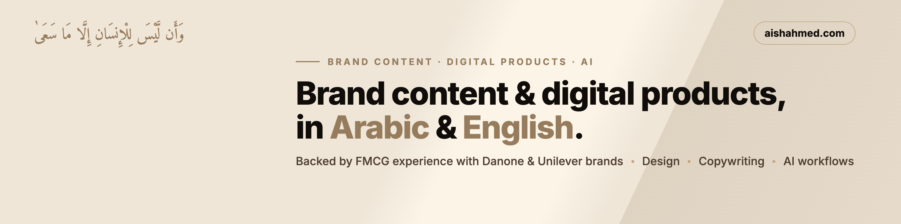

# Hi, I'm Aisha 👋

I create **brand content and digital products in Arabic and English**, combining design, bilingual copywriting and AI workflows.

My background is a mix that rarely sits together:
- **Retail & FMCG:** brand execution with Danone (25 different stores every week) and B2B customer development with Unilever.
- **Software foundations:** Software Development Diploma at **42 Abu Dhabi** (C, Unix, algorithms, peer-to-peer projects).
- **Business:** Bachelor's in Entrepreneurship & Business Administration (UAEU), Six Sigma Green Belt.

I believe every interaction is a chance to leave someone better off.

## What I'm building here
This GitHub is where I publish what I build: websites, small apps, and tools for content and digital products. New projects are added as they ship.

| Project | What it is |
|---|---|
| [Qahwa House](https://aishahmed.com/work/qahwa-house/) | Brand identity and bilingual launch campaign for a specialty coffee concept |
| [Tamra](https://aishahmed.com/work/tamra/) | Shelf to screen: packaging, listing images and a bilingual product page |
| [Focus Week](https://aishahmed.com/work/focus-week/) | A free, printable bilingual planner (digital product) |
| [aishahmed.com](https://github.com/aisha-ahmd/My-Portfolio) | My portfolio: hand-built HTML, CSS and JavaScript with GSAP, hosted on GitHub Pages |

## Tools I work with
`Figma` · `Photoshop` · `Illustrator` · `HTML` · `CSS` · `JavaScript` · `C` · `Git` · `AI image & writing tools`

## Find me
🌐 [aishahmed.com](https://aishahmed.com) · 💼 [LinkedIn](https://www.linkedin.com/in/aishahemd/)
