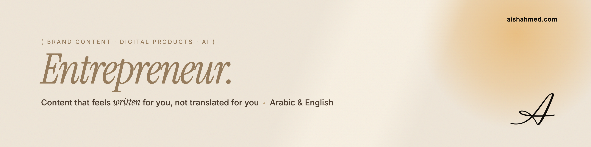

# Hi, I'm Aisha 👋

I believe every interaction is a chance to leave someone better off.

I'm an entrepreneur working on **brand strategy, e-commerce and bilingual web solutions for growing businesses**, in Arabic and English.

My background is a mix that rarely sits together:
- **Retail & FMCG:** Marketing Manager on Danone brands (25 different stores every week), and B2B customer development with Unilever.
- **Brand building:** co-founded The Organic Way, an Emirati natural beauty brand, and led its brand strategy, creative direction and bilingual online store.
- **Software foundations:** Software Development Diploma at **42 Abu Dhabi** (C, Unix, algorithms, peer-to-peer projects).
- **Business:** Bachelor's in Entrepreneurship & Business Administration (UAEU), Six Sigma Green Belt.

## What I'm building
I'm building businesses of my own and learning to evaluate others, with a focus on hospitality, real estate, education, healthcare and Sharia-compliant investing.

This GitHub is where I publish the web side of that work: websites, small apps and tools. New projects are added as they ship.

| Project | What it is |
|---|---|
| [The Organic Way](https://aishahmed.com/work/the-organic-way/) | Real brand: brand strategy, creative direction and a bilingual online store |
| [Tamra](https://aishahmed.com/work/tamra/) | Concept project: packaging, listing images and a bilingual product page |
| [Focus Week](https://aishahmed.com/work/focus-week/) | Concept project: a free, printable bilingual planner |
| [aishahmed.com](https://github.com/aisha-ahmd/My-Portfolio) | My portfolio site: HTML, CSS and JavaScript with GSAP, hosted on GitHub Pages |

## Tools I work with
`Figma` · `Photoshop` · `Illustrator` · `HTML` · `CSS` · `JavaScript` · `Shopify` · `WordPress` · `C` · `Git` · `AI image & writing tools`

## Find me
🌐 [aishahmed.com](https://aishahmed.com) · 💼 [LinkedIn](https://www.linkedin.com/in/aishahemd/) · 📩 connect@aishahmed.com
